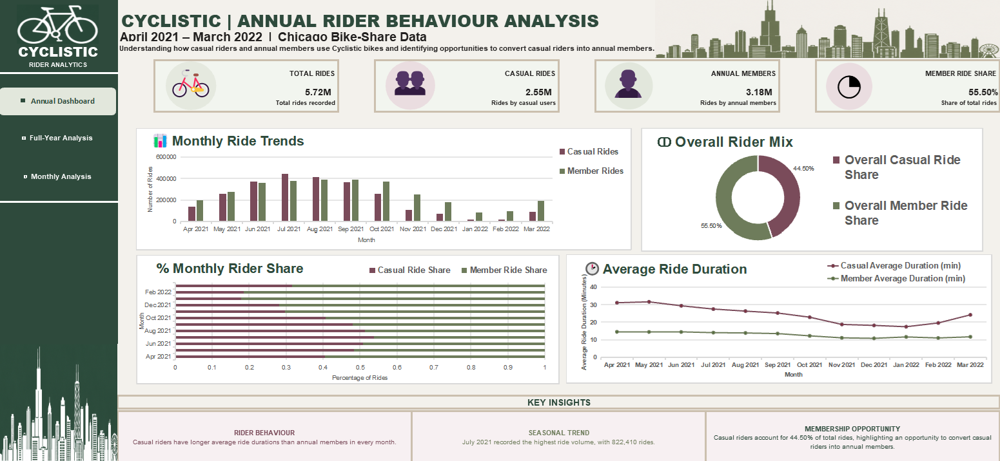

# Cyclistic Bike-Share Analysis

## Project Overview

This project analyzes historical bike-share data from April 2021 to March 2022 to understand how casual riders and annual members use Cyclistic bikes differently.

The goal is to identify riding patterns, uncover differences in rider behavior, and provide data-driven recommendations to help convert casual riders into annual members.

## Business Task

Analyze the differences between casual riders and annual members based on their bike usage patterns, including ride frequency, ride duration, monthly trends, and days of the week.

The findings will help Cyclistic develop marketing strategies to encourage casual riders to purchase annual memberships.

## Data Sources

- **Data Provider:** Motivate International Inc.
- **Dataset:** Divvy historical bike-trip data, used for the fictional Cyclistic case study.
- **Time Period:** April 2021 – March 2022.
- **Data Format:** 12 monthly CSV files.

The dataset contains ride IDs, bike types, trip start and end times, station information, and rider types.

## Tools Used

- **WPS Spreadsheet:** Data cleaning, calculations, analysis, and dashboard creation.
- **WPS Writer:** Project documentation and final report.
- **GitHub:** Project documentation and portfolio presentation.

## Data Cleaning and Preparation

The 12 monthly datasets were organized and examined individually.

The following preparation steps were performed:

- Calculated ride duration using trip start and end times.
- Extracted the day of the week from trip start dates.
- Checked for zero or negative ride durations.
- Identified rides longer than 24 hours.
- Checked for duplicate ride IDs.
- Examined missing station names and station IDs.
- Retained original records and documented data quality issues.

## Analysis and Key Findings

The analysis covered **5,722,533 rides** across the 12-month study period.

Key findings:

- Annual members accounted for **55.50%** of total rides.
- Casual riders accounted for **44.50%** of total rides.
- Casual riders had longer average ride durations than annual members in every month.
- July 2021 recorded the highest monthly ride volume, with **822,410 rides**.
- January 2022 recorded the lowest monthly ride volume, with **103,770 rides**.
- Casual rider activity was strongest during warmer months and weekends.

## Dashboard

The annual dashboard presents four key visualizations:

1. Monthly Ride Trends
2. Overall Rider Mix
3. Monthly Rider Share
4. Average Ride Duration

The dashboard provides a visual comparison of casual riders and annual members across the study period.

## Recommendations

1. **Weekend Membership Promotions:** Introduce targeted membership offers to attract casual riders who frequently ride on weekends.
2. **Promote Membership Benefits:** Highlight the value of annual memberships through campaigns focused on frequent and longer rides.
3. **Seasonal Digital Marketing:** Use targeted campaigns during warmer months when casual riding activity is higher.

## Project Deliverables

This project includes:

- Data analysis and supporting calculations.
- Data cleaning documentation.
- Annual dashboard and visualizations.
- Final case study report.
- Business recommendations.

## Conclusion

The analysis shows clear differences in how casual riders and annual members use Cyclistic bikes. These findings provide insights into rider behavior and support data-driven marketing recommendations aimed at increasing annual memberships.

---

**Project Period:** April 2021 – March 2022  
**Project Type:** Google Data Analytics Capstone Case Study
